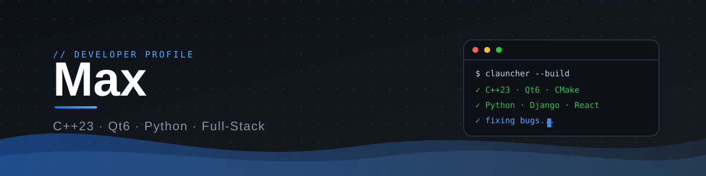

<!-- ================= ШАПКА ================= -->

<!-- ================= КОНТАКТЫ ================= -->

  
  
  <!-- Раскомментируй и подставь свои данные, если захочешь показать почту/Telegram
  
  
  -->

---

### 👨‍💻 About Me

Привет, я **Max** — разработчик, которому нравится собирать вещи с нуля: от нативных десктопных приложений на C++ до полноценных веб-сервисов. Большая часть моих проектов — инструменты вокруг Minecraft и веб-приложения на Django + React.

- 🎮 Пишу **нативные лаунчеры для Minecraft**: [CLauncher](https://github.com/RanoGames/CLauncher) на C++23 + Qt6 и [LightLauncher](https://github.com/RanoGames/LightLauncher) на Python + PyQt6.
- 🌐 Делаю **full-stack**: JSON API на Django + SPA на React/TypeScript/Vite.
- ⚙️ Люблю производительность: минимум зависимостей, параллельные загрузки, быстрый холодный старт.
- 🐧 Работаю в **Linux** и **Windows**, собираю через CMake/qmake, автоматизирую через GitHub Actions.
- 🧐 Сейчас, как и написано в био: **fixing bugs**.

---

### ⚡ Tech Stack

**Languages**

**Frameworks & Libraries**

**Tools & Platforms**

---

### 📊 GitHub Stats

 

 

 

---

### 🐍 Contribution Snake

  <picture>
    <source media="(prefers-color-scheme: dark)" srcset="https://raw.githubusercontent.com/RanoGames/RanoGames/output/github-snake-dark.svg" />
    <source media="(prefers-color-scheme: light)" srcset="https://raw.githubusercontent.com/RanoGames/RanoGames/output/github-snake.svg" />
    
  </picture>

---

### 🚀 Featured Projects

| Project | Description | Stack |
| :------ | :---------- | :---- |
| [**CLauncher**](https://github.com/RanoGames/CLauncher) | Нативный лаунчер Minecraft: манифест Mojang V2, параллельные загрузки с проверкой хешей, менеджер модов и браузер Modrinth, установка Fabric, автопоиск Java, Discord RPC, анализ крашей. | `C++23` `Qt6` `CMake` |
| [**LightLauncher**](https://github.com/RanoGames/LightLauncher) | Лёгкий лаунчер Minecraft на PyQt6: версии, снапшоты и старые сборки, настройка RAM, автопоиск Java, Discord Rich Presence, отладочная консоль. | `Python` `PyQt6` |
| [**Django-Site**](https://github.com/RanoGames/Django-Site) | Карта коллабораций: Django JSON API + React/TypeScript SPA. Авторизация, достижения, команды, уведомления и система наставников. | `Django` `React` `TypeScript` |
| [**HistoryMap**](https://github.com/RanoGames/HistoryMap) | Веб-приложение на Django с интерактивной картой и загрузкой медиа. | `Django` `SQLite` |

---

### 📫 Contact

- 🌐 **Website:** [ranogames.github.io](https://ranogames.github.io)
- 🐙 **GitHub:** [@RanoGames](https://github.com/RanoGames)

*"Make it work, make it right, make it fast."*

